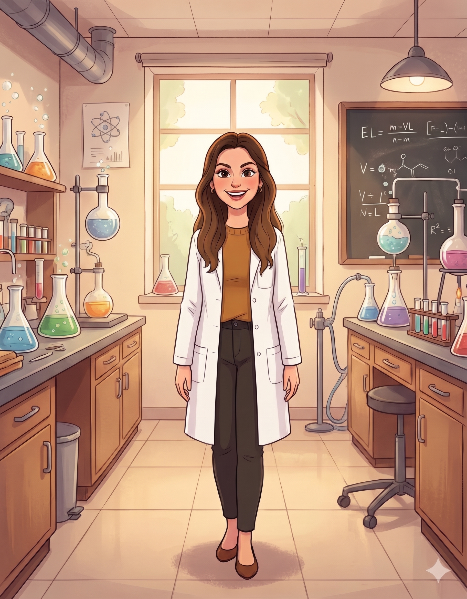

  

    

      <h1>Maya Baranovitch Malka</h1>
      <h2>PhD Student | Weizmann Institute of Science</h2>
    

    
  

## About My Lab and Research
I am a second-year PhD student at [Orly Laufman's Lab](https://www.weizmann.ac.il/molgen/Laufman/home). 
My research focuses on elucidating the role of ER remodeling in enterovirus replication and its underlying mechanisms. 

Enteroviruses dramatically remodel the architecture of their host cells. During infection, the morphology of multiple organelles is altered, and some organelles are destroyed. Moreover, enteroviruses induce the formation of new organelles that exist only in infected cells. All these fascinating changes are part of a viral master plan to transform host cells into virus manufactories.

I investigate how Coxsackievirus B3 remodels the structure and function of the ER, and how the remodeled ER supports or suppresses virus replication.

## Education
* **Ph.D. Student, Molecular Genetics** - *Weizmann Institute of Science*
* **M.Sc. in Cell Biology** - *Tel Aviv University*
* **B.Sc. in Biology** - *Tel Aviv University*

## My Hobbies
I love cooking, graphic design, and spending time with my family.

## Why I Chose This Course
I want to be more efficient with my data analysis, knowing how to incorporate work with different sources, and improve my AI and programming skills.

